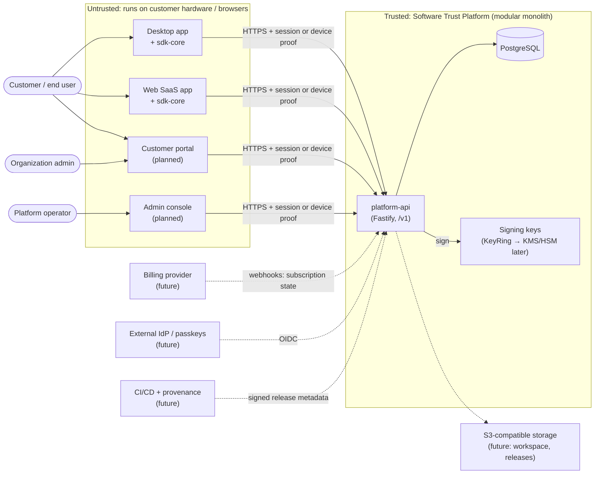
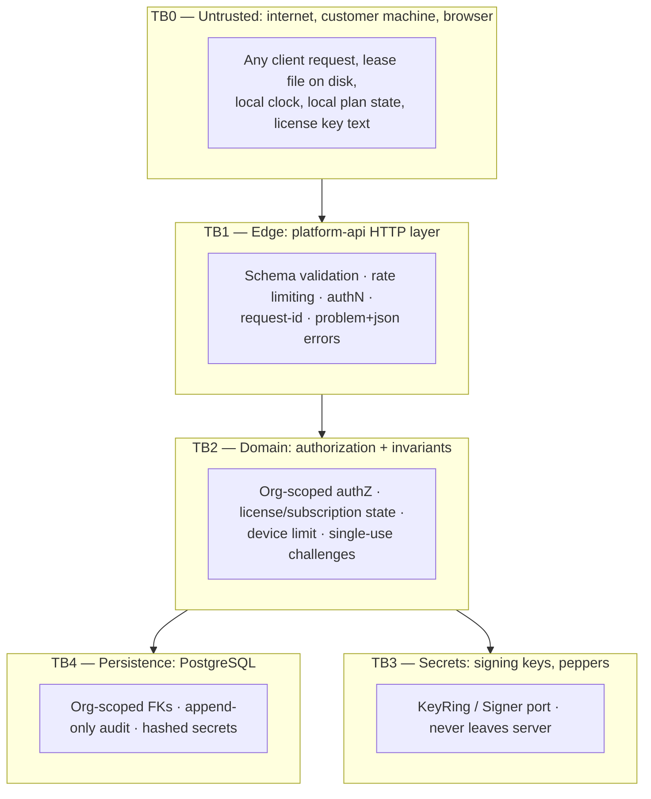

# 01 — System Context, Bounded Contexts, Trust Boundaries

Status: **accepted for V1** · Owner: platform team · Related: [ADR-001](../adr/ADR-001-architecture.md)

## 1. System context



Solid lines exist in V1. Dotted lines are later milestones and are shown so the
V1 seams (ports) are placed correctly.

## 2. Bounded contexts

| Context                                | Responsibility                                                                     | V1 status                          | Package        |
| -------------------------------------- | ---------------------------------------------------------------------------------- | ---------------------------------- | -------------- |
| Shared kernel                          | IDs, error model, decision enum, clock port                                        | V1                                 | `shared-types` |
| Key management                         | Key lifecycle, signing/verification, trust bundle                                  | V1 (software keys, KMS-ready port) | `crypto`       |
| Audit                                  | Tamper-evident, hash-chained audit log                                             | V1                                 | `audit`        |
| Telemetry & security signals           | Allow-listed, content-free telemetry; security signals                             | V1 minimal                         | `telemetry`    |
| Identity & access                      | Users, sessions, organizations, memberships, RBAC                                  | V1 minimal (password + session)    | `auth`         |
| Entitlements                           | Plan → entitlements/capabilities resolution (pure)                                 | V1                                 | `entitlements` |
| Licensing                              | Products, subscriptions, licenses, devices, activations, challenges, signed leases | V1                                 | `licensing`    |
| Client SDK                             | Device key, lease verification, API client                                         | V1                                 | `sdk-core`     |
| Composition / HTTP                     | Wiring, authN/authZ at the edge, API contracts                                     | V1                                 | `platform-api` |
| Trust & risk, policy engine            | Scores, clone detection, progressive enforcement                                   | Milestone 2                        | —              |
| Release security                       | Signed updates, SBOM, provenance                                                   | Milestone 3                        | —              |
| Privacy firewall, security center      |                                                                                    | Milestone 4                        | —              |
| Temporary workspace                    |                                                                                    | Milestone 5                        | —              |
| Privileged admin, dual control, freeze |                                                                                    | Milestone 6                        | —              |

### Allowed dependency direction (enforced by `tools/check-boundaries.mjs`)

```
shared-types ◄── crypto ◄── audit ◄──────────┐
      ▲             ▲         ▲              │
      │             │         │              │
      ├── telemetry │         │              │
      ├── entitlements        │              │
      ├── auth ◄────┘         │              │
      │                       │              │
      └──────────── licensing ┴──────────────┤
                                             ▼
                                        platform-api
sdk-core ──► shared-types, crypto/verify ONLY (never signing code)
```

Rules: no cycles; domain packages never import `platform-api`; **`sdk-core` may
import only the verification-only entrypoint of `crypto`** (structural guarantee
that no signing code is ever bundled into a client).

## 3. Trust boundaries



| Boundary          | What crosses it                                    | Controls                                                                                           |
| ----------------- | -------------------------------------------------- | -------------------------------------------------------------------------------------------------- |
| TB0 → TB1         | Everything from clients                            | TLS, strict zod schemas (unknown keys rejected), body-size limits, rate limits, no secrets in logs |
| TB1 → TB2         | Authenticated `Principal` or verified device proof | Opaque hashed session tokens; Ed25519 proof-of-possession over single-use challenges               |
| TB2 → TB4         | Org-scoped queries                                 | Every repository method takes `orgId`; cross-tenant reads behave as _not found_                    |
| TB2 → TB3         | "Sign this payload for purpose P"                  | `Signer` port; key chosen by purpose + lifecycle state; usage audited                              |
| Platform → client | Signed leases + public trust bundle                | Clients hold **only public** keys; lease is bound to product + installation + device key           |

**Principle:** the client is outside the trust boundary for every commercial
decision. A lease is _evidence issued by the server_, verifiable offline, never
an authority the client can mint or edit.

## 4. V1 request flow (the vertical slice)

```
Operator:   Product → Plan → Subscription → License (key shown once)
Customer:   register/login (personal org) ─┐
Device:     generate Ed25519 key, installation id
            POST /v1/devices/challenges   (single-use nonce, 5 min)
            POST /v1/licenses/activate    (session + license key + signed challenge)
              → license state? subscription entitling? device limit? canary?
              → register device, create activation, resolve entitlements
              → sign lease (bound: product, installation, device key thumbprint)
Offline:    sdk-core verifies lease with public trust bundle + local clock rules
Online:     POST /v1/licenses/validate | /refresh   (device-signed challenge)
              → revoked / suspended / expired subscription → refusal, no new lease
```
