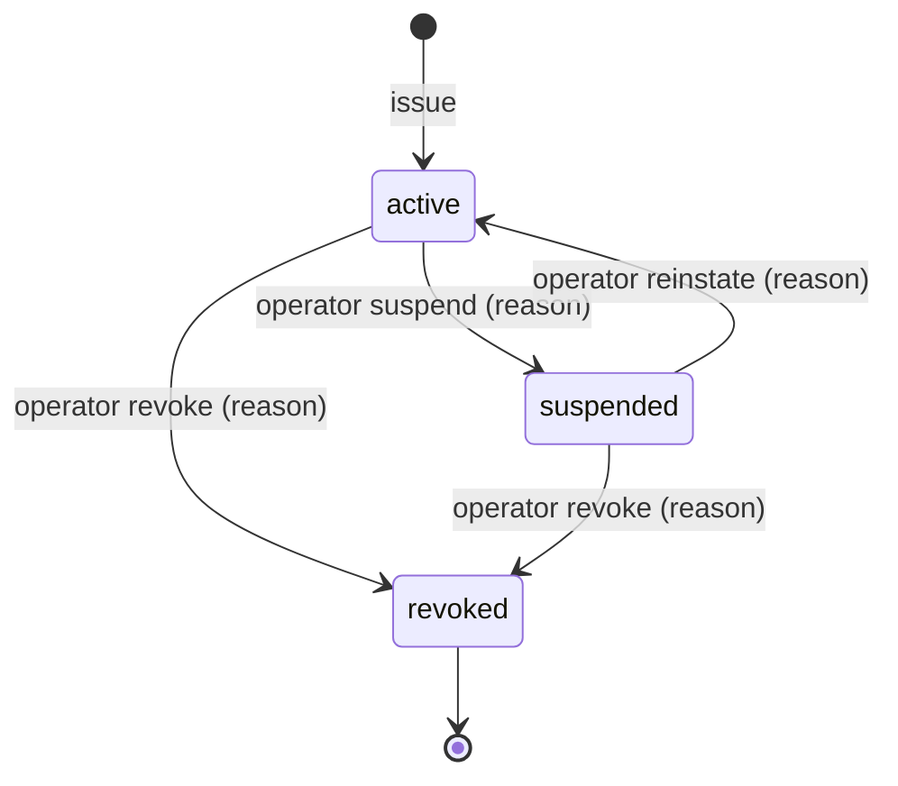

# 02 — V1 Domain Model

Ubiquitous language first; persistence is derived from it (see
[04-database-model](04-database-model.md)).

## 1. The authoritative chain

```
Subscription ──► License ──► Entitlements ──► Capabilities ──► Consumption
 (commercial)   (right to    (resolved,       (runtime         (quota usage —
                 activate)    plan+overrides)  switches)        later milestone)
```

Each link has exactly one owner and no link is inferred client-side.

| Concept          | Meaning                                                                                                                                                                                      | Owner                  | Changes when                                                                   |
| ---------------- | -------------------------------------------------------------------------------------------------------------------------------------------------------------------------------------------- | ---------------------- | ------------------------------------------------------------------------------ |
| **Product**      | Something we ship (`rokela-pdf-pro`)                                                                                                                                                         | licensing              | catalog change                                                                 |
| **Plan**         | Versioned bundle: entitlements, capabilities, device limit, tier                                                                                                                             | entitlements/licensing | pricing/packaging change — takes effect on next refresh, **no client release** |
| **Subscription** | Commercial relationship of an org with a plan, with period and status                                                                                                                        | licensing              | billing events (webhook later; operator in V1)                                 |
| **License**      | The _right to activate_ a product under a subscription (or trial/perpetual). Identified by an opaque `lic_` id; secured by a separate high-entropy **license key** (only its HMAC is stored) | licensing              | issue, suspend, reinstate, revoke                                              |
| **Entitlement**  | A resolved fact: `pdf_editing=true`, `devices=3`, `ocr_pages_monthly=5000`                                                                                                                   | entitlements           | plan version / license override                                                |
| **Capability**   | A named runtime switch derived from entitlements (`OCR_ADVANCED`)                                                                                                                            | entitlements           | same                                                                           |
| **Device**       | A cryptographic identity (Ed25519 public key + thumbprint) registered to an org                                                                                                              | licensing              | first activation                                                               |
| **Installation** | A client-generated random id for one install of a product                                                                                                                                    | client / licensing     | reinstall = new id                                                             |
| **Activation**   | Binding _license ↔ device ↔ installation_. Consumes one device slot while `active`                                                                                                           | licensing              | activate / deactivate / revoke                                                 |
| **Challenge**    | Single-use server nonce proving _current possession_ of the device key                                                                                                                       | licensing              | issued, consumed, expires                                                      |
| **Lease**        | Signed, expiring, device-bound statement of the entitlement snapshot for offline use                                                                                                         | licensing              | refresh                                                                        |

> A license **id** or **key** is never authority by itself. Activation needs
> (1) an authenticated principal who is a member of the license's organization,
> (2) the key, and (3) proof of possession of the device private key.

## 2. Aggregates and invariants

**License (aggregate root)**

- I1. State ∈ {`active`, `suspended`, `revoked`}; `revoked` is terminal.
- I2. _Effective validity_ = state `active` ∧ not past `expiresAt` ∧ (kind has no subscription ∨ subscription entitling).
- I3. Active activations ≤ device limit (plan limit, optionally overridden on the license). Enforced inside one transaction; concurrent activations cannot exceed it.
- I4. `canary` licenses never grant anything; activation is recorded as a security signal and answered exactly like an unknown key.
- I5. Only the key's HMAC is persisted; the plaintext is returned once at issue time.

**Activation**

- A1. Unique active activation per (license, device). Re-activating the same device is **idempotent**: it re-issues a lease and does not consume another slot.
- A2. Deactivation frees the slot immediately; leases already in the field remain valid until `exp` (offline limitation, see threat model T-REV-1) but are refused on the next online contact.
- A3. A device key thumbprint is registered to at most one org (cross-org reuse is rejected as a clone/abuse signal).

**Subscription**

- S1. States: `trialing`, `active`, `past_due`, `suspended`, `canceled`, `expired`.
- S2. _Entitling_ iff (`trialing` ∧ now < trialEnd) ∨ (`active` ∧ now < periodEnd) ∨ (`past_due` ∧ now < periodEnd + dunning grace). Grace is configuration.

**Trial**

- T1. One trial per (product, organization) **and** per (product, user), recorded server-side in `trial_claims`. Reinstalling or deleting local state cannot restart a trial.

**Challenge**

- C1. 256-bit random nonce, bound to (purpose, installation id, optional license id), TTL 5 min, consumed atomically on first valid use (replay-proof), invalidated on failed proof.

**Lease**

- L1. Signed with the active _license-signing_ key; header carries `kid`.
- L2. Bound to product, installation id, device key thumbprint (`cnf.jkt`), license id, activation id.
- L3. `exp` = issue time + tier policy TTL (configuration). `refresh_after` = issue + TTL/2.
- L4. Contains an entitlement **snapshot** (so offline works) and plan version.

## 3. Domain events (all audited; some also telemetry)

`user.registered`, `user.login_succeeded`, `user.login_failed`, `org.created`,
`member.added`, `product.created`, `plan.created`, `subscription.created`,
`license.issued`, `license.suspended`, `license.reinstated`, `license.revoked`,
`trial.started`, `device.registered`, `activation.created`,
`activation.reissued`, `activation.deactivated`, `lease.issued`,
`license.validation_failed`, `security.canary_activated`,
`security.challenge_replay`, `security.device_key_conflict`.

## 4. Policy decision shape (forward-compatible with Milestone 2)

Activation and refresh call an `AccessEvaluator` returning
`{ decision: ALLOW | OBSERVE | STEP_UP_AUTH | RESTRICT | SUSPEND | DENY, reasons[] }`.
V1 implements the deterministic rules above and emits only `ALLOW`/`DENY`; the
Milestone-2 adaptive trust engine replaces the evaluator behind the same
interface, adding risk-weighted graduated outcomes. Hard invariants (signature,
revocation, tenant isolation) always fail closed regardless of score.

## 5. License state machine



Effective validity is _computed_, not stored, so subscription lapse and expiry
need no background job to be correct:

| License state | Subscription     | Expiry        | Effective               | Activate | Validate | Refresh (new lease) |
| ------------- | ---------------- | ------------- | ----------------------- | -------- | -------- | ------------------- |
| active        | entitling / n.a. | future / none | **valid**               | ✔        | ✔        | ✔                   |
| active        | not entitling    | —             | `subscription_inactive` | ✘        | ✘        | ✘                   |
| active        | —                | past          | `expired`               | ✘        | ✘        | ✘                   |
| suspended     | any              | any           | `suspended`             | ✘        | ✘        | ✘                   |
| revoked       | any              | any           | `revoked`               | ✘        | ✘        | ✘                   |

Failure never destroys user data. Clients receive a machine-readable reason and
must degrade to a documented _restricted/read-only_ mode, never delete or lock
documents.

Offline client states (computed by `sdk-core`, never by guess):

| Condition                                                             | State                                   |
| --------------------------------------------------------------------- | --------------------------------------- |
| signature + bindings valid, now < `refresh_after`                     | `valid`                                 |
| valid, `refresh_after` ≤ now < `exp` (± skew)                         | `refresh_recommended`                   |
| now ≥ `exp` + skew                                                    | `expired` (refresh required)            |
| now < `iat` − skew, or now < last-seen − skew                         | `clock_anomaly` (online check required) |
| bad signature / wrong product / installation / device / unknown `kid` | `invalid`                               |
