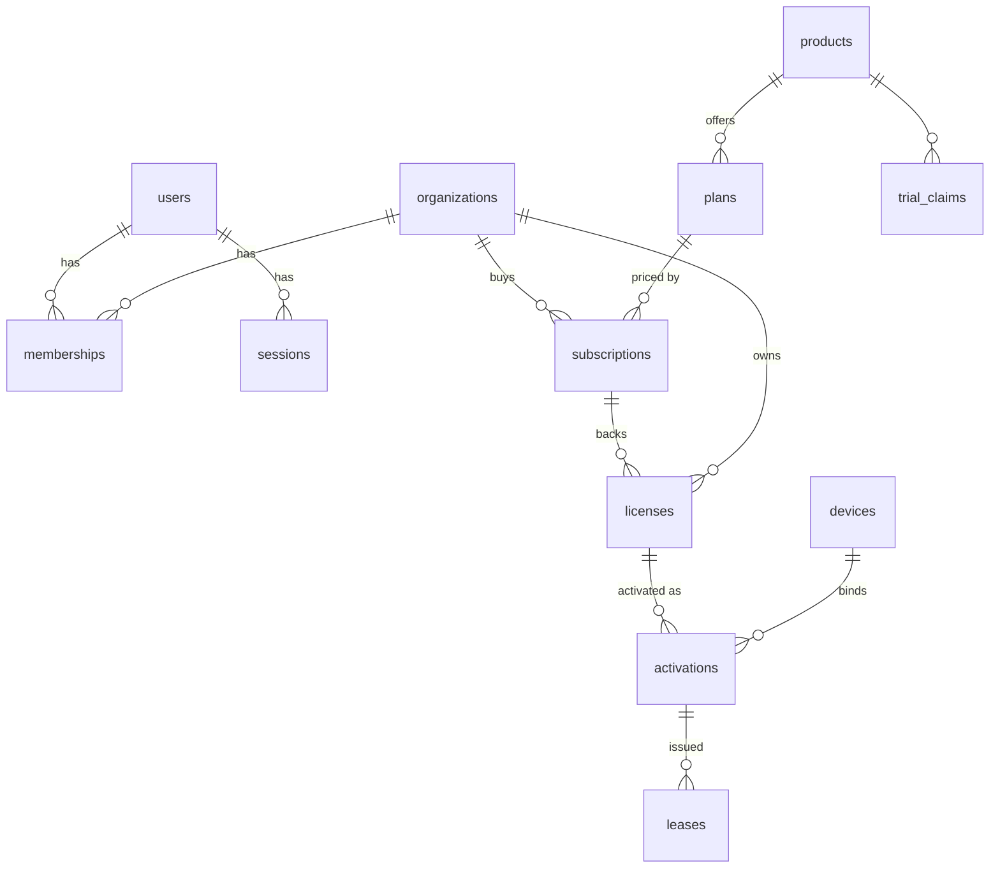

# 04 — V1 Database Model (PostgreSQL)

Source of truth: [`services/platform-api/migrations/0001_init.sql`](../../services/platform-api/migrations/0001_init.sql).
Modeled from the bounded contexts in [02-domain-model](02-domain-model.md), not
from the table list in the brief; tables for later milestones (trust passports,
risk signals, releases, workspace…) are deliberately **not** created yet.

## Design rules

| Rule                             | Mechanism                                                                                                                                                                                                                       |
| -------------------------------- | ------------------------------------------------------------------------------------------------------------------------------------------------------------------------------------------------------------------------------- |
| Tenant isolation                 | `org_id` on every tenant row; **composite FKs** `(id, org_id)` from licenses→subscriptions, activations→licenses/devices, leases→activations. A child cannot reference another tenant's parent even through an application bug. |
| Secrets not stored               | `licenses.key_hash` (HMAC-SHA256 with server pepper), `sessions.token_hash` (SHA-256 of 256-bit token), `challenges.nonce_hash`, `users.password_hash` (scrypt, self-describing).                                               |
| Device slot integrity            | Partial unique index `(license_id, device_id) WHERE status='active'`; limit counted inside a serializable section (`SELECT … FOR UPDATE` on the license row in the PG adapter).                                                 |
| Trial history                    | `trial_claims` unique per (product, org) and (product, user). Never deleted by user flows.                                                                                                                                      |
| One device key, one registration | `devices.thumbprint` globally unique; reuse across orgs is rejected and signalled.                                                                                                                                              |
| Tamper-evident audit             | `audit_events` has `prev_hash/hash` chain, `BEFORE UPDATE/DELETE/TRUNCATE` triggers raise. Application role must also lack `UPDATE/DELETE` grants (deployment doc).                                                             |
| Key custody                      | `signing_keys` stores public metadata + lifecycle only; at most one `active` key per purpose (partial unique index). Private keys live in KMS/secret store.                                                                     |
| Content-free telemetry           | `telemetry_events.attributes` only receives allow-listed attributes (enforced in `telemetry` package; the table cannot enforce it).                                                                                             |

## Migrations

- Forward-only, numbered files, applied by `tools/migrate.mjs` inside a
  transaction; applied versions in `schema_migrations(version, checksum, applied_at)`
  — a changed checksum for an applied version fails the run.
- Tested by `services/platform-api/test/db/migration.test.ts` against a real
  PostgreSQL (CI service container): applies from empty, re-applies idempotently,
  and asserts the constraints above (cross-tenant FK rejection, duplicate
  active activation rejection, audit immutability, one-active-key).
- Recovery: PITR/backups per `docs/runbooks/recovery.md` (written with the
  deployment milestone); schema changes ship expand→migrate→contract.

## Adapters and operations

- Adapters: `services/platform-api/src/db/` (see [ADR-005](../adr/ADR-005-postgresql-adapters.md)).
- Apply schema: `DATABASE_URL=… npm run migrate` (checksummed, advisory-locked, forward-only).
  The server refuses to start on a database that is missing a migration or has an unknown one.
- Test: `npm run test:db` runs the migration/constraint tests, the PostgreSQL adapter tests,
  the port contract suites, and re-runs the licensing, API, security and end-to-end suites
  against PostgreSQL (each test in its own migrated schema).
